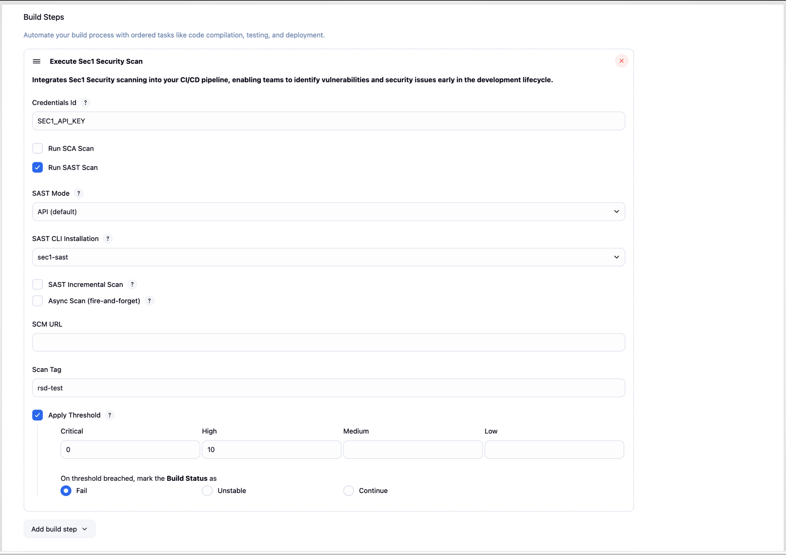

# Sec1 Security Scanner

[](https://sec1.io)

## Introduction

Integrates Sec1 Security scanning into your CI/CD pipeline, enabling teams to identify vulnerabilities and security issues early in the development lifecycle.

## Usage
To use the plugin up you will need to take the following steps in order:

1. [Install the Sec1 Security Plugin](#1-install-the-sec1-security-plugin)
2. [Configure a Sec1 API Token Credential](#2-configure-a-sec1-api-token-credential)
3. [Add Sec1 Security to your Project](#3-add-sec1-security-to-your-project)

## 1. Install the SEC1 Security Scanner Plugin

- Go to "Manage Jenkins" > "System Configuration" > "Plugins".
- Search for "Sec1 Security Scanner" under "Available plugins".
- Install the plugin.

### Custom Endpoints

By default, Sec1 uses the following endpoints:
- **API endpoint**: `https://api.sec1.io`
- **Dashboard endpoint**: `https://unified.sec1.io`

It is possible to configure custom endpoints by setting environment variables:

- Go to "Manage Jenkins" > "System Configuration" -> "System"
- Under "Global properties" check the "Environment variables" option
- Click "Add"
- Set `SEC1_INSTANCE_URL` to override the API endpoint
- Set `SEC1_DASHBOARD_URL` to override the dashboard endpoint (used for report URLs in build output)
- Set `SEC1_MOBILE_BASE_URL` to point `sec1MobileScan` at your Mobile Security scanner nodes. It is separate from `SEC1_INSTANCE_URL` and never derived from it:

  | Deployment | `SEC1_MOBILE_BASE_URL` | Who receives the binary |
  |---|---|---|
  | Hybrid (scanner nodes in your network) | `https://<your-load-balancer>/ai-sast-mobile` | a scanner node inside your network |
  | Sec1 SaaS, no on-prem nodes | leave unset (Sec1 SaaS) | the Sec1 control plane |

  A `baseUrl` set on the step takes precedence. The build log shows which one was used, e.g. `Base URL  https://lb.example.com/ai-sast-mobile (SEC1_MOBILE_BASE_URL)`.


## 2. Configure a Sec1 API Token Credential

- Go to "Manage Jenkins" > "Security" > "Credentials"
- Choose a Store
- Choose a Domain
- Go to "Add Credentials"
- Select "Secret text"
- Add `<YOUR_SEC1_API_KEY_ID>` as ID and Configure the Credentials.
- Remember the "ID" as you'll need it when configuring the build step.

To get `Sec1 Api Key` navigate to [My Account](https://account.sec1.io/) > "Login with GitHub" > Click on profile icon at top right > "Settings"  
- In "API key" section, click on "Generate API key"
- Copy key for use.

<blockquote>
<details>
<summary>📷 Show Preview</summary>


</details>
</blockquote>

## 3. Add Sec1 Security to your Project

This step will depend on if you're using Freestyle Projects or Pipeline Projects.

### Freestyle Projects

- Select a project
- Go to "Configure"
- Under "Build", select "Add build step" select "Execute Sec1 Security Scanner"
- Configure as needed. Click the "?" icons for more information about each option.

<blockquote>
<details>
<summary>📷 Show Preview</summary>



</details>
</blockquote>

### Pipeline Projects

Use the `sec1Security` step as part of your pipeline script. You can use the "Snippet Generator" to generate the code
from a web form and copy it into your pipeline.

<blockquote>
<details>
<summary>📷 Show Example</summary>

```groovy
pipeline {
  agent any

  stages {
    stage('Build') {
      steps {
        echo 'Building...'
      }
    }
    stage('Sec1 Security Scan') {
      steps {
        script {
          sec1Security(
            apiCredentialsId: '<Your Sec1 Api Key ID>',
            scmUrl: 'https://github.com/your-org/your-repo',
            runSca: true,
            runSast: true,
            sastIncrementalScan: false,
            archiveReport: true,
            asyncScan: false,
            scanTag: 'my-scan-tag',
            applyThreshold: true,
            actionOnThresholdBreached: 'unstable',
            threshold: [criticalThreshold: '0', highThreshold: '0', mediumThreshold: '0', lowThreshold: '0']
          )
        }
      }
    }
    stage('Deploy') {
      steps {
        echo 'Deploying...'
      }
    }
  }
}
```

</details>
</blockquote>
You can pass the following parameters to your `sec1Security` step.

#### `apiCredentialsId` (required, default: *none*)

Sec1 API Key Credential ID. As configured in "[2. Configure a Sec1 API Token Credential](#2-configure-a-sec1-api-token-credential)".

#### `scmUrl` (optional, default: *auto-detected*)

Git repository URL to scan. If not provided, the plugin attempts to detect it from the workspace `.git/config` or the `GIT_URL` environment variable. Use this parameter when auto-detection fails (e.g., on some pipeline configurations).

#### `runSca` (optional, default: `true`)

Whether SCA (Software Composition Analysis) scan needs to be executed for the configured git repository.

#### `runSast` (optional, default: `true`)

Whether SAST (Static Application Security Testing) scan needs to be executed for the configured git repository.

#### `scanMode` (optional, default: `api`)

Where scans run — one setting for both SCA and SAST:

- `api` (default) — the Sec1 server clones the repository and runs both scans on its side.
- `cli` — both scans run on the Jenkins agent, so neither your code nor your registry credentials leave the network. Requires `cliInstallation`. See [Running scans on the agent (CLI mode)](#running-scans-on-the-agent-cli-mode).

#### `cliInstallation` (required for `scanMode: 'cli'`)

Name of a **Sec1 CLI** tool installation (Manage Jenkins → Tools → Sec1 CLI). One installation serves both scans.

#### `sbomFile` (optional, CLI mode only)

Workspace-relative path to an SBOM file (JSON) your build already generates. When set, SCA uploads that file instead of generating one. Useful on air-gapped agents or when you keep an SBOM as a compliance artifact.

#### `sastIncrementalScan` (optional, default: `false`)

Run the SAST scan in incremental mode. Only changed code is analyzed, which is faster for large repositories. Requires a baseline full scan to exist on the Sec1 server.

#### `archiveReport` (optional, default: `false`)

Download the PDF report of each scan that ran and archive it with the build, so it opens from **Build Artifacts** on the build page:

| Scan | File | Report |
|---|---|---|
| SCA | `sec1-sca-report.pdf` | SCA Security Assessment |
| SAST | `sec1-sast-report.pdf` | Comprehensive |

Reports are generated on request, which adds a few seconds per scan. They are archived before the threshold is checked, so a build that breaches the threshold still has its reports. If a download fails, the log shows a warning and the build result is not affected. Works in API, SBOM and CLI mode. Not used with `asyncScan` fire-and-forget, since the step does not wait for the scan.

#### `asyncScan` (optional, default: `false`)

Fire-and-forget mode. The plugin submits the scan and exits without waiting for the result, so the pipeline keeps running while the scan completes on the Sec1 server. The report URL is printed in the build log.

If `applyThreshold` is also `true`, the plugin still polls for the result since threshold checks need the final counts. Use `asyncScan` without `applyThreshold` to get true fire-and-forget behavior.

#### `scanTag` (optional, default: *branch name*)

A tag to identify this scan. If not provided, the branch name is used. If the branch name is also unavailable, defaults to `default`.

#### `applyThreshold` (optional, default: `false`)

Whether vulnerability threshold needs to be applied on the build.

#### `threshold` (optional, default: *none*)

Threshold values for each type of vulnerability. Example configuration:
`[criticalThreshold: '0', highThreshold: '10', mediumThreshold: '0', lowThreshold: '0']`

A severity breaches its threshold when its count is non-zero and greater than or equal to the configured value — so `criticalThreshold: '0'` means "fail on the first critical finding", and a clean scan never breaches. On a breach, an error is shown in the console and the build status is set based on `actionOnThresholdBreached`.

#### `actionOnThresholdBreached` (optional, default: `fail`)

The action to take on the build if a vulnerability threshold is breached. Possible values: `fail`, `unstable`, `continue`

## Scan duration

The plugin polls every 10 seconds for the scan result and times out after 30 minutes. For scans that take longer, set `asyncScan: true` (without `applyThreshold`) so the pipeline does not block.

## Running scans on the agent (CLI mode)

By default both scans run on the Sec1 server, which clones your repository. With `scanMode: 'cli'` they run on the Jenkins agent instead — use this when the Sec1 server cannot reach your repository (private SCM, air-gapped network) or your dependencies live in a private registry (Nexus, Artifactory, private npm).

- **SAST** analyzes the checked-out workspace with the `sec1-sast` engine and uploads only the findings report.
- **SCA** resolves your dependencies on the agent, generates an SBOM with the Sec1 CLI and uploads it. Dependencies are resolved with the agent's own toolchain and credentials (`settings.xml`, `.npmrc`, …), so private registries work without giving the Sec1 server access to them.

### One-time setup

1. Go to **Manage Jenkins → Tools → Sec1 CLI installations → Add Sec1 CLI**, name it (for example `sec1-cli`), tick **Install automatically** and choose **Install from sec1.io (latest)**. Each agent downloads the right binaries for its platform on first use and refreshes them daily.
2. Make sure the agent has the project's build tools on its `PATH` — SBOM generation runs them to resolve the full dependency tree: `node`/`npx` for every project, plus `mvn` for Maven projects and `gradle` (or a `./gradlew` wrapper) for Gradle projects. If a tool is installed but not on the agent's `PATH`, add it under **Manage Jenkins → System → Global properties → Environment variables**, for example `PATH+MAVEN` = `/opt/apache-maven-3.9.6/bin`.

   Without the build tool, generation falls back to reading the manifest directly, which captures only direct dependencies — vulnerabilities in transitive dependencies are missed. The scan log warns about this explicitly (see below).

### Using a manually installed Sec1 CLI

For agents that cannot use the auto-installer (air-gapped networks, pinned versions, restricted egress), install the Sec1 CLI with the install script and point the tool installation at it.

**1. Install on the agent**

Linux / macOS:

```sh
curl -fsSL https://storage.googleapis.com/digitalassets-sec1/latest/install.sh | sudo sh -s -- --dir /opt/sec1
```

Windows: follow the manual steps below.

The script detects the platform, downloads both binaries, verifies their SHA-256 checksums (aborting on any mismatch), installs them as `sec1-cli` and `sec1-sast`, and prints the directory to use in Jenkins.

- **Air-gapped agents:** run the script on a connected machine with the agent's platform, then copy the directory to the agent:
  `curl -fsSL …/install.sh | sh -s -- --dir ./sec1 --platform linux-amd64` (also `linux-arm64`, `darwin-amd64`, `darwin-arm64`).
- **Internal mirror:** host the files from `https://storage.googleapis.com/digitalassets-sec1/latest/` in your artifact repository and set `SEC1_DOWNLOAD_URL` to its URL before running the script.

**2. Configure Jenkins**

In **Manage Jenkins → Tools → Sec1 CLI installations**, add an installation, **untick Install automatically**, and set **Installation directory** to the install directory (e.g. `/opt/sec1`). If agents use different paths or platforms, keep the global value as a default and override it per agent under **Manage Nodes → *agent* → Configure → Node Properties → Tool Locations**.

Each scan prints `CLI Version` and `Engine Version`, so you can confirm which binaries an agent used. Manually installed binaries are not refreshed automatically — re-run the script to update.

<details>
<summary>Manual installation without the script (Windows, or as a backup)</summary>

Download the binaries for the agent's platform from `https://storage.googleapis.com/digitalassets-sec1/latest/` and place both in one directory, **renamed** as follows:

| Agent platform | Download | Rename to |
|---|---|---|
| Linux x64 | `sec1-cli-linux`, `sec1-sast-linux-amd64` | `sec1-cli`, `sec1-sast` |
| Linux arm64 | `sec1-cli-linux-arm64`, `sec1-sast-linux-arm64` | `sec1-cli`, `sec1-sast` |
| macOS | `sec1-cli-macos`, `sec1-sast-darwin-arm64` (or `-amd64`) | `sec1-cli`, `sec1-sast` |
| Windows | `sec1-cli-win.exe`, `sec1-sast-windows-amd64.exe` | `sec1-cli.exe`, `sec1-sast.exe` |

On Linux and macOS, make both executable (`chmod +x sec1-cli sec1-sast`). Checksums are published alongside the binaries in `SHA256SUMS.txt` and `sec1-cli-SHA256SUMS.txt`. Then configure Jenkins as in step 2.

</details>

### Pipeline example

Check out the repository before the scan and run the step inside it — CLI mode scans the files in the workspace:

```groovy
pipeline {
  agent any
  stages {
    stage('Sec1 Security Scan') {
      steps {
        checkout scm
        sec1Security(
          apiCredentialsId: '<Your Sec1 Api Key ID>',
          scanMode: 'cli',
          cliInstallation: 'sec1-cli',
          runSca: true,
          runSast: true,
          applyThreshold: true,
          actionOnThresholdBreached: 'unstable',
          threshold: [criticalThreshold: '0', highThreshold: '0']
        )
      }
    }
  }
}
```

`scmUrl` and `scanTag` are optional here: the plugin detects the repository URL and branch from the checkout. If you set them from environment variables, guard against unset values — in Groovy `"${env.REPO_URL}"` becomes the literal string `null` when the variable is missing. Use `scmUrl: env.REPO_URL ?: ''` instead.

### What you will see

- Every CLI-mode scan prints the engine/CLI version it ran (`Engine Version …`, `CLI Version …`), so you can tell which build produced the findings.
- **Multi-module repositories:** one SBOM is generated and uploaded per package-manager location (each Maven module, each `package.json` directory, …), so the Sec1 dashboard shows findings per module. Thresholds apply to the combined totals.
- **C/C++ repositories:** third-party libraries vendored into the source tree are identified from their version headers, compiled binaries and directory layout — the same fingerprinting the Sec1 server uses.
- **Incomplete SBOM warning:** if the agent cannot resolve dependencies (build tool missing, private registry unreachable), the log shows `SBOM may be INCOMPLETE …`. Treat findings from that run as a lower bound and fix the agent setup.
- Output from the SBOM generator and build tools is kept out of the console and written to `sec1-sbom-generation.log` in the workspace; the last lines are shown automatically if generation fails.
- `asyncScan` and `sastIncrementalScan` are ignored in CLI mode; scans run synchronously on the agent.

### Older parameters

Configurations written for earlier releases keep working: `sastMode: 'cli'` with `sastInstallation`, and `scaMode: 'sbom'` with `scaInstallation`. They set each scan separately and need separate tool installations; prefer `scanMode` with a single `cliInstallation` for new jobs.

## Mobile app scanning (`sec1MobileScan`)

Scans a built mobile app binary (`.apk`, `.aab`, `.ipa`, also `.xapk` and split bundles) with Sec1 Mobile Security. It is a separate step from `sec1Security` because it runs on the build output rather than the source, so place it after the stage that produces the binary. It uses the same Sec1 API key credential (the account needs the Mobile Security plan).

```groovy
stage('Build APK') {
  steps { sh './gradlew assembleRelease' }
}
stage('Sec1 Mobile Scan') {
  steps {
    sec1MobileScan(
      apiCredentialsId: '<Your Sec1 Api Key ID>',
      binaryPath: 'app/build/outputs/apk/release/*.apk',
      appName: 'my-app',
      environment: 'uat'
    )
  }
}
```

The step uploads the binary from the agent (or, with `artifactUrl`, has the scanner node fetch it from Artifactory), waits for the scan to finish (typically 5–20 minutes) while printing its progress, prints a link to the results in the Sec1 console, archives the findings as `sec1-mobile-findings.json`, and applies the vulnerability threshold if one is configured. If the build is aborted, the scan is cancelled.

| Parameter | Default | Description |
|---|---|---|
| `apiCredentialsId` | `SEC1_API_KEY` | Secret text credential holding the Sec1 API key |
| `binaryPath` | *required without `artifactUrl`* | Workspace-relative path to the binary; wildcards allowed, must match exactly one file |
| `artifactUrl` | — | Artifactory download URL of the binary; the scanner node fetches it instead of an upload (see below) |
| `artifactSha256` | computed from `binaryPath` when set | SHA-256 of the binary at `artifactUrl`; a mismatch with Artifactory's checksum is refused |
| `appName` | binary or artifact file name | Application name shown in the console |
| `appVersion` | build number | Version recorded with the scan |
| `environment` | — | Free-text label, e.g. `uat`, `prod` |
| `scanType` | `owasp` | `owasp`, `quick`, `compliance` or `deep`; a label recorded on the scan, the same analysis runs for all |
| `applyThreshold` | on when `threshold` is set | Set `false` to keep a configured `threshold` without applying it |
| `threshold` | *none* | Per-severity thresholds, e.g. `[criticalThreshold: '0', highThreshold: '5']` |
| `actionOnThresholdBreached` | `fail` | `fail`, `unstable` or `continue` when a threshold is breached |
| `minScore` | *none* | Breach when the aggregate score is below this value |
| `baseUrl` | Sec1 SaaS | For on-premises scanner nodes: your load balancer URL, e.g. `https://scanner.example.com/ai-sast-mobile` (or set `SEC1_MOBILE_BASE_URL`) |
| `pollIntervalSeconds` | `20` | How often to check progress (minimum 10) |
| `timeoutMinutes` | `45` | Total time the step waits, a resubmission included; when it runs out the build fails and the scan keeps running in the console |
| `resubmitPartial` | `true` | Resubmit once when a scan is interrupted (`partial`); never after a timeout such as `stale_scan_timeout` |
| `archiveFindings` | `true` | Archive `sec1-mobile-findings.json` with the build |
| `archiveReport` | `false` | Download the executive PDF report and archive it as `sec1-mobile-report.pdf` (see below) |
| `source`, `engagementId` | `jenkins:JOB#BUILD`, — | Provenance label and engagement grouping |

### Scanning a build from JFrog Artifactory

If the build already publishes the package to Artifactory, pass its download URL instead of uploading it again. The scanner node downloads the file itself, using the Artifactory credential configured on the node, so Jenkins needs no Artifactory plugin or credential for this step. This requires the one-time Artifactory setup on the scanner node (described in *Sec1 Mobile Security — Scanning builds straight from JFrog Artifactory*, available from Sec1); the node's `/health` then reports `"artifactory":"ok"`.

#### Passing the URL from your publish step

Whatever publishes the build to Artifactory knows the file's download URL, and usually its SHA-256. Capture both in the publish stage and hand them to `sec1MobileScan`. The examples assume `SEC1_MOBILE_BASE_URL` points at your scanner nodes (see [Custom Endpoints](#custom-endpoints)); otherwise add `baseUrl` to the step. They read JSON with `readJSON` from the [Pipeline Utility Steps](https://plugins.jenkins.io/pipeline-utility-steps/) plugin.

**JFrog CLI (`jf rt upload`).** `--detailed-summary` prints the target URL and SHA-256 of each uploaded file:

```groovy
stage('Publish APK') {
  steps {
    script {
      def out = sh(returnStdout: true, script: '''
        jf rt upload --detailed-summary "app/build/outputs/apk/release/app-release.apk" \
          "mobile-releases/my-app/${BUILD_NUMBER}/"
      ''')
      def file = readJSON(text: out).files[0]
      env.ARTIFACT_URL = file.target      // https://artifactory.example.com/artifactory/mobile-releases/my-app/42/app-release.apk
      env.ARTIFACT_SHA256 = file.sha256
    }
  }
}
stage('Sec1 Mobile Scan') {
  steps {
    sec1MobileScan(
      apiCredentialsId: 'SEC1_API_KEY',
      artifactUrl: env.ARTIFACT_URL,
      artifactSha256: env.ARTIFACT_SHA256,
      appName: 'my-app',
      environment: 'uat'
    )
  }
}
```

The same works with the Jenkins JFrog plugin's `jf` step, which runs the same CLI.

**Artifactory REST API (`curl -T`).** The deploy response contains `downloadUri` and `checksums.sha256`:

```groovy
stage('Publish APK') {
  steps {
    withCredentials([usernamePassword(credentialsId: 'artifactory-deployer',
                                      usernameVariable: 'ART_USER', passwordVariable: 'ART_PASS')]) {
      script {
        // Single quotes: the shell, not Groovy, expands the credentials, so they stay masked.
        def out = sh(returnStdout: true, script: '''
          curl -sSf -u "$ART_USER:$ART_PASS" \
            -T app/build/outputs/apk/release/app-release.apk \
            "https://artifactory.example.com/artifactory/mobile-releases/my-app/${BUILD_NUMBER}/app-release.apk"
        ''')
        def deployed = readJSON(text: out)
        env.ARTIFACT_URL = deployed.downloadUri
        env.ARTIFACT_SHA256 = deployed.checksums.sha256
      }
    }
  }
}
```

Follow it with the same `Sec1 Mobile Scan` stage as above.

**Gradle or Maven publishing.** These do not print the URL, but it follows from the repository layout, so build it from the same values the publish task uses. Pass `binaryPath` so the step computes the SHA-256 from the file it just built:

```groovy
stage('Publish APK') {
  steps {
    sh './gradlew publish'   // publishes to mobile-releases as com/example/my-app/<version>/my-app-<version>.apk
  }
}
stage('Sec1 Mobile Scan') {
  steps {
    script {
      def version = "1.4.${env.BUILD_NUMBER}"
      sec1MobileScan(
        apiCredentialsId: 'SEC1_API_KEY',
        artifactUrl: "https://artifactory.example.com/artifactory/mobile-releases/com/example/my-app/${version}/my-app-${version}.apk",
        binaryPath: 'app/build/outputs/apk/release/*.apk',   // only for the checksum; not uploaded
        appName: 'my-app',
        appVersion: version
      )
    }
  }
}
```

Jenkins only needs Artifactory credentials for the publish step. The scan step never contacts Artifactory: the scanner node downloads the file with its own read credential, so the URL must be in a repository the node is configured for.

#### Rules

- `artifactUrl` must be under the Artifactory base and repository configured on the node, end in `.apk`, `.aab`, `.xapk` or `.ipa`, and contain no credentials.
- With `artifactUrl` set, `binaryPath` is never uploaded. If it is set and `artifactSha256` is not, the step sends the workspace file's SHA-256, which ties the scan to the exact binary this build produced. Without either, the node still verifies the download against Artifactory's own checksum.
- The download is the scan's first phase (`fetching_artifact`). If Artifactory cannot be reached at submission (HTTP 502 `artifactory_unreachable`), the submission is retried, since a failed submission never creates a scan. Configuration errors (`artifact_url_not_allowed`, `artifactory_auth_failed`, `artifact_not_found`, `artifact_checksum_mismatch`) fail the build with a hint.

### Vulnerability threshold

The threshold works the same way as in `sec1Security`. **By default no threshold is applied:** findings are reported, archived and linked in the console, but they do not change the build result.

When a threshold is set, a severity breaches when its count is non-zero and greater than or equal to the configured value, so `criticalThreshold: '0'` fails on the first critical finding and `highThreshold: '5'` passes with 4 High findings and breaches with 5. A blank severity is not checked. `minScore` breaches when the aggregate score is below the value. On a breach, the reasons are printed in the console and the build is set according to `actionOnThresholdBreached`.

```groovy
sec1MobileScan(
  apiCredentialsId: '<Your Sec1 Api Key ID>',
  binaryPath: 'app/build/outputs/apk/release/*.apk',
  applyThreshold: true,
  actionOnThresholdBreached: 'unstable',
  threshold: [criticalThreshold: '0', highThreshold: '5'],
  minScore: 40
)
```

In freestyle jobs the same options are under **Apply Threshold** in the step configuration, and the **Pipeline Syntax** snippet generator produces the matching `sec1MobileScan` line.

A scan that is interrupted on the server side (`partial`, e.g. the scanner node restarted) is resubmitted once automatically, unless `resubmitPartial: false`. It is not resubmitted when the reason is a timeout (`stale_scan_timeout`): the scanner node stopped the scan at its own per-scan time limit, and a new scan would stop at the same point, so the build fails with that reason. If an app regularly needs longer, ask the node operator to raise the node's limit. A failed scan fails the build with the reason from the server; threshold options do not apply to it.

### PDF report

Set `archiveReport: true` to keep the executive PDF report with each build. After a completed scan, the step requests the report, waits while it is generated (up to 10 minutes), and archives it as `sec1-mobile-report.pdf` next to the findings, so it opens from the build page. This happens before the threshold is checked, so a build that breaches the threshold still has its report.

```groovy
sec1MobileScan(apiCredentialsId: 'SEC1_API_KEY', artifactUrl: env.ARTIFACT_URL, archiveReport: true)
```

The report is requested from the base URL first. If the scanner nodes do not serve it, it is fetched from the Sec1 control plane, so in a hybrid setup the agent then needs to reach Sec1. If the report cannot be downloaded, the log shows a warning and the build result is not affected.

### Timeouts

`timeoutMinutes` is the total time the step waits, including a resubmission. If you also wrap the stage in a Pipeline `timeout`, make that a few minutes longer, so the step reports its own timeout first:

```groovy
timeout(time: 100, unit: 'MINUTES') {
  sec1MobileScan(apiCredentialsId: 'SEC1_API_KEY', artifactUrl: env.ARTIFACT_URL, timeoutMinutes: 90)
}
```

When `timeoutMinutes` runs out, the build fails but the scan keeps running, and its result appears in the Sec1 console. When the build is aborted, including by a Pipeline `timeout`, the step cancels the scan on the scanner node.

## Troubleshooting

To see more information on your steps:

- View the "Console Output" for a specific build.

---

-- Sec1 team
